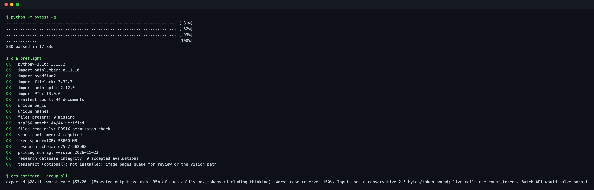

# CRA Performance Evaluation Extraction Pipeline

**LLM-powered document-intelligence pipeline** that converts Community Reinvestment Act (CRA) Performance Evaluation PDFs from three U.S. bank regulators (FDIC, FRB, OCC; 1997–2026) into a **linked, evidence-backed relational dataset** (SQLite / CSV / Excel) for economic research, with cost governance, automated validation and release gates built in.

> **Keywords:** document AI / intelligent document processing · LLM structured extraction · data provenance & lineage · ETL / data pipelines · schema and rule-based validation · human-in-the-loop review · inter-rater agreement scoring · cost estimation & budget controls · batch inference · reproducibility · Python · SQLite · pytest · GitHub Actions

## Highlights

- **100% evidence traceability:** all **21,387 of 21,387** extracted values are linked to their source PDF page and verbatim quote, and values whose supporting text is not found on the cited page are rejected automatically.
- **Cost-efficient at scale:** about **$0.0062 per page (~$0.27 per evaluation)** with the Anthropic Batch API, enforced by an offline cost estimator and a spend ledger with a hard budget cap (**$30 spent of a $150 budget, zero overruns**) across 44 evaluations / 1,870 pages.

## Tech stack

| Area | Technologies |
|---|---|
| Language / tooling | **Python 3.10+**, `pytest`, `ruff`, GitHub Actions CI matrix (3 OS × 2 Python versions) |
| LLM extraction | **Anthropic Claude API** (JSON-schema outputs, **Batch API**, token counting), saved-response cache for deterministic rebuilds |
| Document processing | `pdfplumber`, `pypdfium2` (page rendering), page classification (text / OCR layer / scanned) |
| Storage / export | **SQLite** (versioned schemas and migrations), CSV, Excel (`openpyxl`) |
| Pipeline controls | `cra` CLI: `preflight`, `estimate`, `extract`, `validate`, `freeze`, `packet`, `review`, `score`, `export`; file locking, SHA-256 input verification, release gates |

## Pipeline

PDF acquisition and hashing → page inventory and scan detection → section-windowed LLM extraction (one request per section/table) → evidence verification → rule-based validation (sum checks, rating vocabulary, date consistency, run-to-run disagreement) → human review queue → blind reference coding and agreement scoring → gated export (`exports/vN/` only if every gate passes, otherwise a labelled `DRAFT`/`UNVERIFIED` folder).

## Screenshot

*Offline verification, no API key required.*



## Quick start (offline, no API key)

```bash
python -m venv .venv && source .venv/bin/activate
python -m pip install -e ".[dev]"
python -m pytest -q          # 230 tests
cra preflight                # input integrity checks
cra estimate --group all     # offline cost estimate, no spend
cra rehearse                 # mock end-to-end plumbing check
```

Paid runs read `ANTHROPIC_API_KEY` from your shell environment only (never from a file) and require an explicit `--yes-spend`. See `START_HERE.md` for the full run order. Source PDFs, databases and generated exports are **not** stored in git; they are regenerated by the pipeline.

## Status and honesty

This is a **pilot draft**: values have not been checked by a person, and the only reference set is a second model reading, so the measured figures are *agreement*, not accuracy. The export is therefore labelled UNVERIFIED and the release gates stay unmet by design. The full list of limitations follows.

---

## Using the data: how to read and trust it

**In one sentence:** 44 public bank evaluations (PDFs written by US bank regulators under the Community Reinvestment Act) were turned into spreadsheet-style tables by an AI model, and this folder explains how to open those tables, analyse them, and, most importantly, **how far to trust them**.

---


## 1. What is in the folder

Open **`exports`**, then the folder starting with **`DRAFT-`**:

| What | Name | Use it for |
|---|---|---|
| **The workbook (start here)** | `CRA_pilot_tables.xlsx` | All tables in one Excel file, bank names filled in |
| The source PDFs | `source_pdfs/` (44 files) | Checking any value |
| One file per table | `table_a_...csv` ... `ltd_peers.csv` | Other software; see Section 6 |
| Examiner phrase counts | `examiner_phrase_frequency.csv` | How often each phrase is used |
| The database | `research.sqlite` | People who write queries (Section 6) |
| What was done and what went wrong | `pilot_memo.md`, `error_log.md`, `RELEASE_STATUS.json` | Method, costs, problems, unmet checks |

> Keep `CRA_pilot_tables.xlsx` and `source_pdfs/` **next to each other**, or the PDF links stop working.

## 2. Quick start (3 minutes)

1. Double-click **`CRA_pilot_tables.xlsx`**.
2. If a yellow bar says **Protected View**, click **Enable Editing**. (The workbook has no macros.)
3. Read the **READ ME FIRST** tab, then open **Evaluations**.

### The tabs

| Tab | One row is... | Rows |
|---|---|---|
| **Evaluations** | one bank evaluation; the last column opens its PDF | 44 |
| **Exam summary** | headline facts: date, exam type, ratings, assets, loan-to-deposit ratio | 44 |
| **Products** | one loan product reviewed (mortgage, small business, small farm, consumer) | 107 |
| **Areas** | one **assessment area**, a geography the bank is judged on | 141 |
| **Distributions** | one line of a statistics table, e.g. "low-income borrowers: bank 17%, all lenders 12%, population 20%" | 1,050 |
| **Conclusions** | one examiner judgment, with the exact words ("reflects reasonable distribution") | 2,684 |
| **LTD peers** | one comparison bank in the loan-to-deposit comparison | 59 |
| **Evidence** | for every value: the **PDF page** and the **exact text** it came from | 21,387 |
| **Phrases** | each examiner phrase and how often it appears, by regulator and exam type | 913 |
| **Needs review** | problems the automatic checks found (sort by `blocks_release`) | |
| **Data dictionary** | what each column means | |

**Reading the cells**
- **Empty = the PDF does not print it, or it could not be confirmed.** It is **not** zero. A real zero shows as `0`.
- **Percentages are plain numbers:** `23.4` means 23.4%.
- Some values stay as **text** because the PDF prints units, such as `76.10 percent`.
- Agency names appear as printed, so "FRB" and "Federal Reserve" are the same body. Ratings may be in capitals (`SATISFACTORY`); Excel filters ignore the difference.

## 3. Filter, sort, summarise (the only skills you need)

- **Filter / sort:** click the small arrow on a column header (filters are already on).
- **Search:** Ctrl+F (Windows) or Cmd+F (Mac).
- **Summarise:** click inside a table, then **Insert > PivotTable > OK**. Drag a column into **Rows**, another into **Columns**, and one into **Values** (choose **Count** to count).

### Questions you can answer

**How are banks rated, by regulator?** Tab *Exam summary*. PivotTable: Rows `agency`, Columns `rating_overall`, Values `evaluation_id` (Count). (35 Satisfactory, 8 Outstanding, 1 not printed.)

**Which examiner words are most common?** Tab *Phrases*. Sort `times_used` from largest. To find all wordings of one idea, filter with **Text Filters > Contains** `reasonable`. Phrases are kept exactly as written, so similar wordings are counted separately.

**How does one bank compare with all lenders and with the population?** Tab *Distributions*. Filter `bank`, `product`, `dimension`. Read, for each income group (`category`): the bank's share (`bank_count_pct`, column J), all lenders (`aggregate_pct`, M) and the population (`demographic_pct`, N). For the gap, put this in a new column, row 2, and drag down: `=IF(OR(J2="",N2=""),"",J2-N2)`. Negative = the bank lends less to that group than its share of the population. First read `demographic_base`: it says what the population share counts (families, households, businesses...) and it differs between tables.

**Compare loan-to-deposit ratios.** Tab *Exam summary*, column T is text (`76.10 percent`). New column, row 2: `=IFERROR(VALUE(SUBSTITUTE(T2," percent","")),"")`. Values printed as `82%` come out blank; read the text. Only 21 of 44 evaluations have this value.

**Where did the data come from, and how much was inside the assessment area?** Tab *Products*. Pivot `product` by `data_source`; `inside_aa_count_pct` is the share of loans made inside the assessment areas.

**Which evaluations discuss a topic?** Tab *Conclusions*, filter `context_reasons_text` with **Contains** `competition` (or `poverty`...). `pdf_page` says where to look.

With 44 evaluations (8 to 11 in each period) treat any trend over time as a hint, not a finding.

## 4. Checking a value against the PDF (do this before relying on a number)

1. Note the **bank** and the **pdf_page** (Distributions and Conclusions show it; otherwise use the *Evidence* tab).
2. *Evidence* tab: filter `bank` and `field_name`. `evidence_verbatim` is the exact text the value came from.
3. *Evaluations* tab: click the link at the end of the bank's row to open the PDF.
4. Go to that **PDF page**. Page 1 is the first page of the file, which can differ from the printed page number.
5. If the PDF disagrees with the workbook, **the PDF is right**.

## 5. Other ways in

- **Google Sheets:** sheets.google.com > Blank > File > Import > Upload `CRA_pilot_tables.xlsx` > *Insert new sheet(s)*. (PDF links will not work there.)
- **Numbers / LibreOffice:** both open `.xlsx`; menus differ.
- **A single `.csv`:** use Excel's **Data > From Text/CSV** and choose **UTF-8**. An empty value is written `\N`. The `safe_for_spreadsheets` folder has copies Excel will not misread.
- **Database:** install the free **DB Browser for SQLite** (sqlitebrowser.org), open `research.sqlite`, and use *Browse Data* or *Execute SQL*, for example:
  ```sql
  SELECT agency, rating_overall, COUNT(*) FROM table_a_exam_level GROUP BY 1,2;
  SELECT lower(label_verbatim) p, COUNT(*) n FROM table_e_examiner_conclusions GROUP BY p ORDER BY n DESC LIMIT 10;
  ```
  Tables join on `pe_id` (called `evaluation_id` in the workbook).


## 6. How to run it (all free, no key needed)

```bash
python -m venv .venv && source .venv/bin/activate     # Windows: .venv\Scripts\Activate.ps1
python -m pip install -e ".[dev]"
python -m pytest -q                                    # 230 tests
cra preflight                                          # checks the 44 PDFs by hash
cra extract --group all --run-id run1 --staging data/staging/run1.sqlite --effort-for e=medium --cache-only   # rebuild tables from saved model output
cra validate --run-id run1 --staging data/staging/run1.sqlite                                                # automatic checks
cra export --database data/staging/run1.sqlite --scores reports/holdout_scores_auto_v2.json --indicators reports/mortgage_indicators_proposed.json --output exports
```

Expect `calls: 0` and `cost: 0.0` on every document in the extract step. If a call or a cost appears, stop. The export also builds the Excel workbook. It is written to `exports/UNVERIFIED-<timestamp>/`; open `CRA_pilot_tables.xlsx` there. The export is labelled UNVERIFIED until the review gates in Section 7 pass.

Re-running extraction (paid) requires `ANTHROPIC_API_KEY` and `--yes-spend`; see `cra extract --help`. The AI step uses `claude-sonnet-5-5`, the Batch API, and a saved response cache in `data/model/cache` (not in git, along with the PDFs, databases and exports).

Where things are: `MEMORY.md` (project state, decisions, history) · `START_HERE.md` (run order) · `docs/coding_handbook.md` (field rules) · `docs/research_data_dictionary.md` · `docs/edge_case_coverage.md` (tests against the edge-case list in `EDGE_CASES.md`) · `docs/acquisition_readme.md` (how the PDFs were collected) · `reports/error_log.md`, `reports/pilot_memo.md`.
